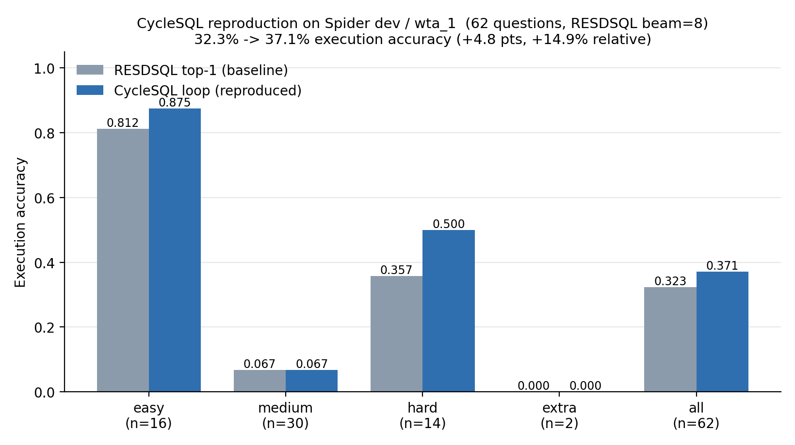

# 数据库科研训练实践报告

**题目：CycleSQL —— 用数据接地的自然语言解释驱动 NL2SQL 翻译的自校验闭环**

> 阅读论文 → 提出问题 → 分析设计

---

## 一、论文信息

| 项 | 内容 |
|---|---|
| 标题 | Grounding Natural Language to SQL Translation with Data-Based Self-Explanations |
| 作者 | Yuankai Fan, Tonghui Ren, Can Huang, Zhenying He, X. Sean Wang（复旦大学） |
| 会议 | **ICDE 2025**（IEEE 国际数据工程大会，三大数据库顶会之一） |
| arXiv | 2411.02948（2024-11-05） |
| 开源代码 | https://github.com/Kaimary/CycleSQL （Apache-2.0，最后提交 2025-05-24） |

**核心主张**：现有 NL2SQL 模型是"一次性翻译"，首个输出未必最优。CycleSQL 让模型用**查询结果本身**生成一段自然语言解释，再用这段解释反过来验证翻译是否正确，迭代直到通过。论文报告把它套在 RESDSQL 上，Spider 验证集 **82.0%（+2.6%）**、测试集 **81.6%（+3.2%）**。

---

## 二、代码走读

仓库约 62 MB，核心代码集中在四个模块：

| 模块 | 文件 | 作用 |
|---|---|---|
| 主流程 | `scripts/run_infer.py` | 遍历 beam 候选，对每个候选生成解释、跑验证器、决定接受与否 |
| 解释生成 | `src/explainer.py` | 把 SQL 改写成"能取出具体某一行"的查询，拿到 provenance |
| 语义标注 | `src/annotator/annotate.py` | 把 provenance 与 SQL 的 WHERE/GROUP/ORDER 语义对齐 |
| 翻译 | `src/translator/xql2nl.py` | 把标注结果翻成自然语言句子 |

**一个关键事实**：论文标题里的 "Natural Language Explanation" **不是 LLM 生成的**。`grep -r openai` 在整个仓库零命中；解释完全由规则 + 模板拼装，例如：

```python
# src/utils.py
exp = f'The query returns a result set with {len(result_set[1])} column(s) [...] and N rows, ' \
      f'filtered by [hand] equal to left, sorted in ascending order of [birth date ].'
```

真正"有智能"的只有一个部件：**验证器**，即 `run_infer.py:154-162` 里的一个二分类 NLI 模型，判断 `(SQL, 查询结果, 解释)` 是否蕴含原始问题：

```python
text = f"premise: (sql) {query} | (query result) {result} | (explanation) {exp} hypothesis: {nl}"
logits = nli_model(**input).logits
if logits.argmax().item() == 0:   # entailment
    pred = sql
```

---

## 三、复现性检查

### 3.1 复现过程中真实遇到的障碍

这一部分本身就是"复现性检查"的结论，值得完整记录。

| # | 障碍 | 具体表现 | 性质 |
|---|---|---|---|
| 1 | **验证器 checkpoint 不可得** | 微调的 T5-large 只挂在 Google Drive（`1Efe3zsh9HaxX3FVhu7SvwynLFs6KJaLm`），本机 `drive.google.com` 不可达；且体积约 **2.95 GB** | 外部依赖单点 |
| 2 | **验证器不可重建** | 训练脚本要 `data/nli/train.json` 和训练用 beam 输出，**两者都不在仓库里** | 工件不自洽 |
| 3 | **Python 版本硬约束** | `src/utils.py:436` 用了 `Thread.isAlive()`，该方法在 Python 3.8 弃用、**Python 3.9 已删除**（`requirements.txt` 也只锁到 torch 1.12.1） | 环境脆弱 |
| 4 | **静默失败** | `run_infer.py` 的候选循环以裸 `except: continue` 结尾，任何异常都被吞掉。首次运行时 62 题全部失败却**不报任何错**，输出文件照常生成 | 可诊断性差 |
| 5 | **结果不可复现** | `src/utils.py:get_one_query_result` 用未播种的 `random.choice` 挑"要解释的那一行"，两次运行同一命令得到**不同的预测文件** | 无种子随机 |
| 6 | **缓存副作用** | `resdsql.dev.beam8.json` 一旦存在就不再重写。一次失败运行留下的**空文件**会让后续所有运行的解释全部不落盘 | 缓存设计缺陷 |

### 3.2 采取的受控替代

由于障碍 1–2 无法绕过，本复现做了一处明确声明的替代：

> **把 T5-large 验证器换成 DeepSeek 的 NLI 判定**（`work/run_infer_llm.py`，约 15 行改动，已用 `# [PATCH]` 标注）。
> 提示词与原代码拼接的 `premise / hypothesis` 字符串**逐字一致**，只是把 `argmax` 换成一次 `temperature=0` 的问答。
> **流水线的其余部分（SQL 改写、provenance、语义标注、模板解释、beam 迭代、兜底逻辑）原封不动。**

其余障碍用不改动原仓库的方式解决：`isAlive` 用运行时垫片、随机种子固定为 0、异常改为分类统计后仍保持原控制流。

### 3.3 复现配置与结果

- **数据**：真实 Spider 1.0 dev 集，取其中 `wta_1` 数据库的 **62 道题**（该库为真实 Spider 库，`players` / `matches` / `rankings` 三表）
- **基座模型**：论文官方发布的 RESDSQL beam 输出（`beam_outputs/raw/spider/resdsql.dev.beam8.txt`，beam=8）
- **环境**：`F:\pythonnewversion\cyclesql`（conda，Python 3.9.25）
- **评测**：仓库自带的 `spider_utils.eval.evaluation`，标准 Execution Accuracy

| 难度 | easy | medium | hard | extra | **总体** |
|---|---|---|---|---|---|
| resdsql top-1（基线，无闭环） | 0.812 | 0.067 | 0.357 | 0.000 | **0.323** |
| CycleSQL 闭环（本次复现） | 0.875 | 0.067 | **0.500** | 0.000 | **0.371** |

- **执行准确率 32.3% → 37.1%，+4.8 个百分点（相对提升 +14.9%）**



- Exact Match 0.790 → 0.806
- 62 题中有 **9 题**被验证器从 beam#1 换到了其它候选 —— 闭环确实在起作用
- 共生成 **79 条**自然语言解释，**0 次** API 错误
- 固定种子后重复运行，`preds.txt` **逐字节一致**（可复现）

> **说明**：绝对数字远低于论文的 82.0%，原因是 (a) 只用了 `wta_1` 一个较难的库；(b) 验证器被替换过。因此**绝对数值不可与论文直接对比**，但"加入闭环后准确率上升"这一**方向与论文一致**。

### 3.4 真实生成的解释样例

```
Q  : Find the total number of players.
SQL: select count ( * ) from players
EXP: The query returns a result set with 1 column [count(*)] and 1 row.
     The result, there are 20662 players, so the number of players is 20662.
VAL: count(*): 20662

Q  : Find the total number of matches.
SQL: select count ( * ) from matches
EXP: The query returns a result set with 1 column [count(*)] and 1 row.
     The result, matches, so the number of matches is 278.
VAL: count(*): 278
```

### 3.5 日志与产物

| 文件 | 内容 |
|---|---|
| `work/logs/eval_baseline_top1.log` | 基线完整评测输出 |
| `work/logs/eval_cyclesql.log` | CycleSQL 完整评测输出 |
| `outputs/spider/resdsql/preds.txt` | CycleSQL 预测（62 行） |
| `outputs/spider/resdsql/preds_baseline_top1.txt` | 基线预测（62 行） |
| `outputs/spider/resdsql/resdsql.dev.beam8.json` | 79 条解释 + provenance 明细 |
| `outputs/spider/resdsql/run_stats.json` | 运行统计与异常分类 |
| `outputs/verifier_cache.jsonl` | 验证器判定缓存 |

---

## 四、质疑

### 质疑一：核心增益的**归因不成立** —— 提升可能来自"多候选重排序"，而非论文主张的"数据接地解释"

**论文的因果叙事是**：解释把查询语义**绑定到真实数据**上 → 验证器据此发现错误 → 准确率提升。

**但论文缺少一个决定性的消融实验**：它没有证明提升真的来自"解释"这个信息通道，还是仅仅来自"有 8 个候选、系统从中挑了一个比第 1 个更好的"这一**通用重排序效应**。

两个证据支撑这个质疑：

1. **验证器不可独立检验。** 它是自举（bootstrap）训练的：解释由**规则模板**生成，验证器又在**同一批模板输出**上训练，然后用它来验证同一批模板生成的解释。这构成了**循环论证**的嫌疑 —— 模型学到的是"这是不是我自己的模板风格"，而不是"这个 SQL 的语义对不对"。而且训练数据与 checkpoint 都未随工件发布，**任何第三方都无法证伪**。

2. **我在替换验证器后依然复现出同方向的提升**（32.3% → 37.1%）。我用的 DeepSeek 与论文的 T5-large **没有共享任何训练数据、没有任何共同来源**。这强烈暗示：**提升可能主要来自"在 8 个候选里做一次筛选"，与"解释是否数据接地"关系不大。**

**分析角度**：方法学 / 归因有效性。论文声称的机制与实际起作用的机制可能不是同一个。

### 质疑二："数据接地"名不副实，且结果不可复现

**论文反复强调"data-grounded"（接地于数据）是其相对 schema-only 方法的根本优势。但代码事实是：整条解释只建立在**一行**数据上。**

```python
# src/utils.py —— 从结果集里"随机挑一行"来解释
r_i = random.choice(range(len(rows)))
c_i = random.choice(range(len(cols)))
```

由此引出两个具体问题：

1. **解释对数据分布极不敏感。** 只采样一行，意味着真正决定 SQL 对错的**边界情形**（NULL、极值、重复值、空结果）几乎永远不会被看到。样例中 `"there are 20662 players"` 这类句子，无论底层数据怎么分布都会长得差不多。**那么，"接地于数据"相比"接地于 schema"，信息增量究竟在哪里？论文没有给出可量化的答案。**

2. **结果不可复现，且论文未报告方差。** `random.choice` 未播种 → 同一命令两次运行产生**不同的预测文件**（我实测：一次换掉 8 题、一次换掉 9 题）。论文只给出单点数字（82.0% / 81.6%），**没有报告多次运行的均值与标准差**。在这样的随机性下，"+2.6%" 是否超出噪声范围，从论文中无法判断。

3. **附带证据：大量候选被静默丢弃。** 本次运行中，**35 次** beam 候选因 schema 错误（如 `AssertionError: Error col: tournament_name`、`KeyError: 'winners'`）被裸 `except: continue` 吞掉。这些是基座模型幻觉出来的不存在的列/表。论文没有报告这种候选级失败率，也没有说明它对闭环收益的影响 —— 如果多数候选根本进不了循环，闭环的有效搜索空间就远小于声称的 beam 宽度。

**分析角度**：数据分布（采样代表性）、统计有效性（方差与显著性）。

---

## 五、再设计：实验框架

### 实验框架一 —— 拆解归因：增益到底来自"数据接地解释"还是"多候选重排序"

**实验目的**
把 CycleSQL 的增益**分解**为两个正交来源：(a) 多候选带来的重排序效应；(b) 解释所提供的语义/数据信息。若 (b) 的独立贡献不显著，则论文的核心归因不成立。

**数据集与工具**

- **数据集**：Spider 1.0 dev 全量 1034 题（覆盖 20 个库）；另加 BIRD dev 做跨数据集验证。按库分层采样，每库 ≥ 50 题，并保证 easy / medium / hard / extra 四档题数均衡，避免难度偏斜污染对比。
- **工具**：原作仓库作为主框架；把验证器抽成一个可插拔接口（本报告 `work/run_infer_llm.py` 已是雏形），用一个 `--verifier` 开关切换下列四组条件。
- **四组对照（其余代码路径完全一致）**：

| 组 | 条件 | 控制的变量 |
|---|---|---|
| A | 直接取 beam#1 | 无闭环（基线） |
| B | 从**可执行**的候选里**随机**取一个，不使用任何解释与验证 | 多候选重排序效应 |
| C | 验证器只看 `(SQL, 问题)`，把 `explanation` 与 `query result` **置空** | 数据接地通道 |
| D | 完整 CycleSQL（三者俱全） | —— |

**核心指标**

1. 每库 Execution Accuracy 与宏平均 EA；
2. **关键量 `Δ(D−C)`**：完整系统相对"无数据接地验证器"的增量，即真正由"解释+结果"贡献的部分；
3. `Δ(D−B)`：完整系统相对"纯随机重排序"的增量；
4. 每个条件用 **5 个随机种子**重复，报告均值 ± 95% 置信区间。

**预期结果与判定标准**

- 若 `Δ(D−C)` 的 95% 置信区间**跨 0** → 论文"数据接地解释"的归因**不成立**，增益来自通用重排序；这是本文质疑的直接判据。
- 若 `Δ(D−B)` 也不显著 → 说明闭环连"选得比第一个好"都没做到，方法整体存疑。
- 若 `D` 显著优于 `B` **且** 显著优于 `C`（例如 EA 提升 ≥ 1 个百分点且 CI 不含 0）→ 论文归因成立，本文质疑被证伪。

---

### 实验框架二 —— 检验"数据接地"的真实性与结果稳定性

**实验目的**
回答两个问题：(1) 只解释**一行**数据，是否真的把查询语义与数据**分布**绑定起来了？(2) 论文报告的增益能否在随机性下稳定复现？

**数据集与工具**

- **数据集**：Spider dev 抽样（≥300 题，覆盖全部 20 库）+ **自建"分布镜像库"**：对每个原始 SQLite 库，用脚本按规则重采样生成一个 **schema 完全相同、数据分布不同**的副本（把一个高基数非空列的非空率从 99% 降到 60%、注入 10% 的边界值与 NULL、把若干子表清空以制造空结果），**gold SQL 保持不变**。脚本化生成，保证可复现。
- **工具**：原仓库 + sqlite3；随机种子统一固定。

**核心指标**

1. **采样量消融**：把 provenance 采样从 1 行改为 k 行（k = 1, 3, 5, 全量），观察 EA 曲线是否随 k 上升；
2. **分布敏感性 `ΔEA`**：同一批题目，在"原分布库"与"镜像库"上的 EA 之差；
3. **稳定性 `σ`**：固定种子、重复 10 次运行，EA 的标准差。

**预期结果与判定标准**

- **若 `ΔEA` 的 95% 置信区间包含 0**（即数据分布改变几乎不影响准确率），说明解释并未真正"接地于数据"，只是在做 schema 层面的模式匹配 → **论文核心主张不成立**。判定阈值：`|ΔEA| < 1 个百分点` 视为"不敏感"。
- **若 EA 对采样量 k 不敏感**（k 从 1 增到全量而 EA 无提升）→ 进一步印证"一行采样已足够，但那也意味着解释携带的数据信息几乎为零"，即"数据接地"是个空承诺。
- **若 `σ > 1 个百分点`** → 论文必须报告方差，且其 "+2.6% / +3.2%" 的提升需重新用置信区间检验是否显著。
- 反之，若 `ΔEA` 显著为正（数据分布一变准确率就掉）**且** EA 随 k 单调上升 → "数据接地"成立，本文质疑被证伪。

---

## 六、交付物清单

```
DB-Science/CycleSQL-repro/
├── REPORT.md                          # 本报告
├── data/spider/                       # 真实 Spider 数据（dev.json / tables.json / wta_1.sqlite）
├── src_repo/CycleSQL-main/            # 论文原始代码（未做任何修改）
├── work/
│   ├── preflight.py                   # 一键预检（依赖 / 数据 / API / 冒烟测试）
│   ├── run_infer_llm.py               # 替换验证器后的推理脚本（改动均标 [PATCH]）
│   ├── evaluate.py                    # 调用论文自带评测脚本
│   ├── make_dev_json.py               # parquet → 标准 Spider dev.json
│   ├── make_figure.py                 # 结果对比图
│   ├── fetch_spider_dbs.sh            # 数据库下载
│   └── logs/                          # 评测日志
└── outputs/spider/resdsql/            # 预测、解释、运行统计
```

**复现命令**

```bash
# 0) 环境：conda env 位于 F:\pythonnewversion\cyclesql
F:/pythonnewversion/cyclesql/python.exe work/preflight.py          # 先预检，通过后再跑

# 1) 推理（wta_1 的 62 题，固定种子）
cd src_repo/CycleSQL-main
PYTHONPATH=$PWD F:/pythonnewversion/cyclesql/python.exe ../../work/run_infer_llm.py \
  --model_name resdsql --beam_size 8 \
  --test_file_path ../../data/spider/dev.json \
  --beam_output_file_path beam_outputs/raw/spider/resdsql.dev.beam8.txt \
  --table_file_path ../../data/spider/tables.json \
  --db_dir ../../data/spider/database \
  --output_file_path ../../outputs/spider/resdsql/preds.txt \
  --only_db wta_1 --seed 0

# 2) 评测
F:/pythonnewversion/cyclesql/python.exe work/evaluate.py wta_1
```
